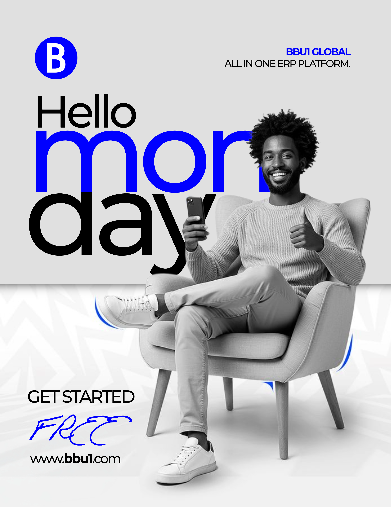

# Kendrick Jalar — IT, Web & Communications Portfolio

Welcome to my digital portfolio showcasing web platforms, systems deployment, and graphic design work.

> **Note on Repositories:** Source code repositories for client and organizational projects are kept private to protect organizational security and intellectual property. Live production links, active development previews, and visual design samples are available directly below.

---

## Live Production Websites

* **UPLUS Empowerment & Transformation International** — [uplusint.org](https://uplusint.org/)  
  *Status: Live* | Full website deployment, Cloudflare hosting/DNS management, email routing, and ongoing IT administration.

* **BBU1 (Litonu Business Base Universe)** — [bbu1.com](https://www.bbu1.com/en)  
  *Status: Live* | Product development, user workflows, and digital marketing campaigns for an SME business management platform.

---

## In Active Development (Staging)

* **Jeroma Smiles** — [jeroma-smiles.pages.dev](https://jeroma-smiles.pages.dev/)  
  *Status: Under Development* | Responsive web platform built for a children's art and digital literacy initiative in Entebbe.

---

## Posters & Graphic Design

| Campaign / Event Poster | Program / Brand Visual |
| :---: | :---: |
|  |  |
|  |  |
